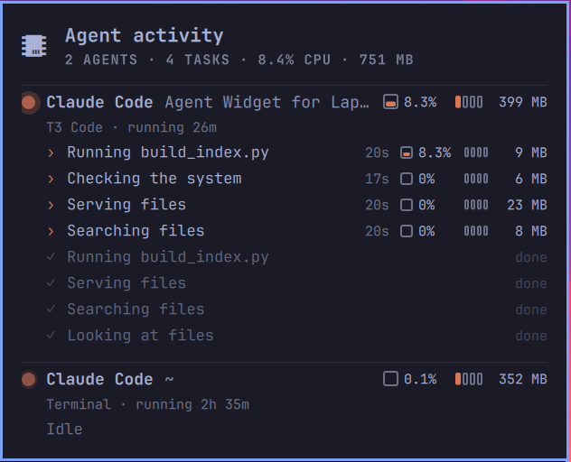

# Agent Activity

An Omarchy bar widget that shows what your AI coding agents are doing on your
machine right now: which agents are running, every command each one has
started, a short plain-English summary of it, and the CPU and memory it uses.



## What it shows

- **Bar icon.** A chip icon with the number of agent commands running right
  now. It dims when no agent is running. Click it to open the panel; Esc closes it.
- **One block per agent.** Claude Code, Codex, Gemini CLI, OpenCode, Kimi Code,
  Aider, Goose, Crush, Amp, Cursor Agent, Copilot CLI, Qwen Code, Droid and Grok
  CLI are recognised. A coloured dot glows brighter the harder the agent works.
- **Where it runs.** The app it runs in (T3 Code, a terminal, VS Code, Zed, tmux,
  ...), its project folder, and how long it has been running. For agents started
  by T3 Code, the T3 thread title is shown instead of the folder.
- **Each command.** A short summary such as "Running Rust tests" or
  "Searching files", its age, CPU and memory. Finished commands stay for 20
  seconds, ticked and dimmed. Background jobs that outlive the shell that
  started them are still credited to the right Claude Code session.
- **MCP servers** the agent keeps running, on one line.
- **Gauges.** CPU is a chip that fills in four steps (0.5%, 4%, 15% and 40% of the
  whole machine). Memory is a stick whose four chips light at 100 MB, 500 MB,
  2 GB and 8 GB.

Full command lines are never displayed. Summaries are masked for passwords,
tokens, API keys, auth headers and URL credentials. Masking works by pattern,
so a secret with no recognisable name or shape could still appear: take care
when sharing screenshots.

## Install

```bash
omarchy plugin add https://github.com/Bliggs1984/omarchy-agent-activity --enable
```

Or place it in the bar yourself: add `{ "id": "io.github.bliggs1984.agent-activity" }`
to a section of `bar.layout` in `~/.config/omarchy/shell.json`.

## Remove

```bash
omarchy plugin remove io.github.bliggs1984.agent-activity
```

## Requirements

- Omarchy with the Quickshell-based shell.
- `python3` (standard library only; already present on Omarchy).

Nothing else is installed, and the plugin never writes to disk or the network.

## How it works and what it reads

`scan.py` runs as one small background process started by the widget, at low
priority. Every 5 seconds (2 seconds while the panel is open) it reads
`/proc/<pid>/stat` for each process. For agents and the processes under them it
also reads, once per process:

- `/proc/<pid>/cmdline`, to summarise the command;
- `/proc/<pid>/cwd`, for the project folder;
- `/proc/<pid>/environ` of your own processes, but keeps only `CLAUDE_PID`,
  `T3CODE_THREAD_ID` and `CODEX_THREAD_ID` (used to link a job to its session);
- T3 Code's local database `~/.t3/userdata/statev2.sqlite`, read-only, to look up
  a thread title by its id. If T3 Code is not installed this is skipped.

It prints one line of JSON to the widget when something visible changes, and exits when the shell
closes its input.

## Cost

Measured on a 12-thread laptop: about 0.3% of one CPU core (0.02% of the whole
machine) and 16 MB of memory, with the panel open or closed. The panel's
contents are only built while it is open.

## Development

- `python3 scan.py --once` prints one snapshot.
- `python3 -I tests/test_scan.py` runs the tests.
- After editing `Panel.qml`, run `omarchy restart shell` if a change doesn't appear.

## License

MIT
